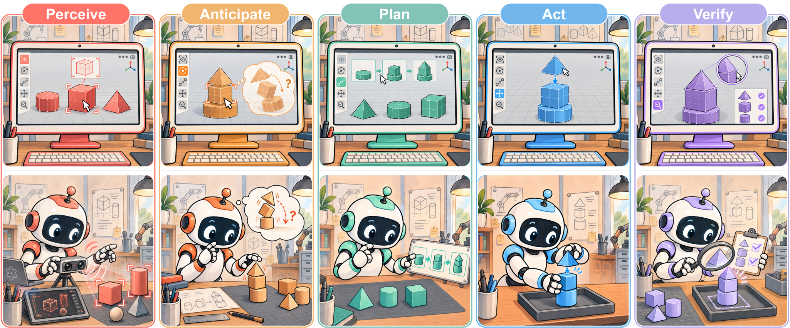
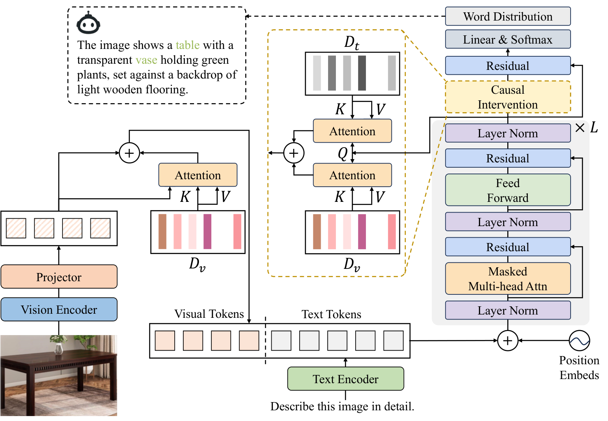

<section id="about" class="fade-section">
  <h2>About</h2>
  

    I am an MS student at the <strong>National University of Singapore (NUS)</strong>, working with
    <a href="https://sites.google.com/view/showlab/home" target="_blank"><strong>Show Lab</strong></a> and advised by
    Prof. <a href="https://zhen720.github.io/" target="_blank">Mike Zheng Shou</a>.
    Prior to NUS, I received my B.E. in Computer Science from <strong>Zhejiang University</strong>,
    where I was advised by Prof. Juncheng Li.
  

   
  

    My research lies at the intersection of <strong>embodied AI</strong>, <strong>multimodal large language models</strong>,
    and <strong>3D scene understanding</strong>. I am passionate about building AI systems that can perceive,
    reason about, and act in the physical world. My work includes physical necessity reasoning for heterogeneous
    multi-robot manipulation (<a href="https://arxiv.org/abs/2611.32803" target="_blank">MRBench</a>),
    hallucination mitigation in LVLMs, and real-time scene understanding for wearable smart-vision aids.
  

</section>

<section id="news" class="fade-section">
  <h2>News</h2>
  

    2026.11
    Paper <a href="https://arxiv.org/abs/2611.32803" target="_blank"><em>MRBench</em></a> is available on arXiv: benchmarking physical necessity reasoning in heterogeneous multi-robot manipulation.
  

  

    2026.09
    Survey Released <em><a href="https://showlab.github.io/Awesome-Multimodal-Embodied-Agent/" target="_blank">Awesome Multimodal Embodied Agents: From Computer-Use to Robot-Use</a></em> — PAPAV (Perceive → Anticipate → Plan → Act → Verify), a capability-centric map of the Agent × Robotics landscape, with an analysis of 64 benchmarks.
  

  

    2026.03
    Joined Alibaba Tongyi Lab (Wanxiang) as Data &amp; Algorithm Intern, working on universal inverse dynamics models and cross-domain action alignment.
  

  

    2025.11
    Joined ACE Robotics as Embodied Intelligence Intern, working on Qwen3-VL fine-tuning and spatial intelligence data pipelines.
  

  

    2025.05
    Paper <em>Causal-LLaVA</em> published on arXiv — mitigating hallucinations in multimodal LLMs via causal disentanglement.
  

  

    2025.04
    Joined Unitree Robotics as Assistant Engineer, developing guidance systems for the Unitree G1 humanoid robot.
  

</section>

<section id="publications" class="fade-section">
  <h2>Publications</h2>
  

    <button class="pub-thumb pub-video" type="button" aria-label="Play MRBench Spring Doors demo">
      <video muted loop playsinline preload="metadata" poster="/images/papers/mrbench-cover.jpg" aria-hidden="true">
        <source src="/images/papers/mrbench-demo.mp4" type="video/mp4">
      </video>
    </button>
    

    

      MRBench: Benchmarking Physical Necessity Reasoning in Heterogeneous Multi-Robot Manipulation
      arXiv 2026
    

    
Yanzhe Chen, Zhijun Cao, <strong>Ruihe An</strong>, Chang Gong, Mike Zheng Shou

    
<a href="https://arxiv.org/abs/2611.32803" target="_blank">arXiv:2611.32803</a> &nbsp;·&nbsp; <a href="https://showlab.github.io/MRBench/" target="_blank">Project Page</a>

    

  

  

    <a class="pub-thumb papav-thumb" href="https://showlab.github.io/Awesome-Multimodal-Embodied-Agent/" target="_blank" rel="noopener noreferrer">
      PAPAV
      
    </a>
    

    

      Awesome Multimodal Embodied Agents: From Computer-Use to Robot-Use
      Survey 2026
    

    
Yanzhe Chen, Ziyi Yang, Jifeng Zhu, Qiming Huang, <strong>An RuiHe</strong>, Peiyao Xu, Hesen Yang, Runda Liu, Chang Gong, Zhijun Cao, Zechen Bai, Wenzheng Zeng, Yiqi Lin, Guoqiang Liang, Kevin Yuchen Ma, Kevin Qinghong Lin, Mike Zheng Shou&dagger; (Show Lab, NUS)

    
<a href="https://arxiv.org/abs/2610.30108" target="_blank" rel="noopener noreferrer">arXiv:2610.30108</a> &nbsp;·&nbsp; <a href="https://github.com/showlab/Awesome-Multimodal-Embodied-Agent/blob/main/assets/SURVEY_Multimodal_Embodied_Agent.pdf" target="_blank">PDF</a> &nbsp;·&nbsp; <a href="https://showlab.github.io/Awesome-Multimodal-Embodied-Agent/" target="_blank">Project Page</a> &nbsp;·&nbsp; <a href="https://github.com/showlab/Awesome-Multimodal-Embodied-Agent" target="_blank">GitHub</a>

    

  

  

    
    

    

      Causal-LLaVA: Causal Disentanglement for Mitigating Hallucination in Multimodal Large Language Models
      arXiv 2025
    

    
Xinmiao Hu, Chun Wang, <strong>An RuiHe</strong>, ChenYu Shao, Xiaojun Ye, Sheng Zhou, Liangcheng Li (Zhejiang University)

    
<a href="https://arxiv.org/abs/2505.19474" target="_blank">arXiv:2505.19474</a>

    

  

</section>
